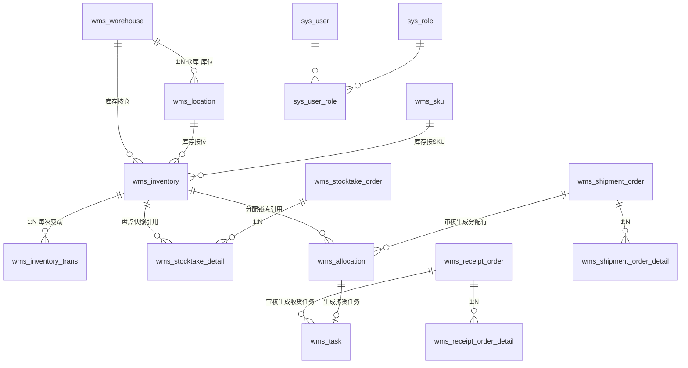

# WMS 数据库设计

> MySQL 8.0.16+（依赖 CHECK 约束强制执行）｜ 全表 InnoDB / utf8mb4
> 生产结构以 `migrations/versions` 中的版本化迁移为准；开发 debug 模式可使用 AutoMigrate。

数量字段（库存现存/可用/分配/冻结量、库存流水前后量、单据及明细进度、分配、任务、盘点）统一为有符号 INT；业务非负量最大 2147483647，差异和流水变化允许负数。Go 模型显式指定 `type:int;size:32`，避免 64 位 Go 的默认 int 被映射为 BIGINT。正式 SQL 已是 INT，本轮不修改已发布迁移，也不新增收窄生产字段的迁移。

波次汇总行 `wms_wave_line.target_qty/picked_qty` 是跨订单汇总，使用 BIGINT；分货项数量仍为 INT。二者有独立进度 CHECK，正式启动同时验证，详见[波次设计与迁移](wave-picking.md)。

开发 AutoMigrate 在任何改表前跨租户检查已有数量字段（包含软删数据）；发现不适合 INT 的历史值立即返回错误，保留原结构与数据，交由人工审计。开发迁移期间须停止其他写入进程。生产结构由版本化初始化迁移及后续增量迁移共同定义；本文件提供设计说明，实际执行语句以迁移文件为准。000001 顶部的历史说明已更正，未改变任何 SQL 语句。

## 1. 表清单总览（25 张业务与系统表，不含 schema_migrations）

| 分组 | 表 | 说明 |
| --- | --- | --- |
| 系统管理 | `sys_user` | 用户（bcrypt 密码） |
| | `sys_role` | 角色（权限串 `perms`） |
| | `sys_user_role` | 用户-角色关联 |
| | `sys_oper_log` | 操作日志（异步写入） |
| 基础数据 | `wms_warehouse` | 仓库 |
| | `wms_location` | 库位（`{库区}-{排}-{列}`） |
| | `wms_sku` | 货品（编码/条码唯一） |
| **库存** | **`wms_inventory`** | **库存数量行（核心）** |
| | **`wms_inventory_trans`** | **库存流水（对账依据）** |
| | `wms_inventory_alert_rule` | 仓库+货品可用库存下限配置（迁移000013），见[库存预警](inventory-alerts.md) |
| | `wms_inventory_movement` | 同仓移库凭证与来源/目标库存（迁移000014），见[仓内移库](stock-movement.md) |
| 任务 | `wms_task` | 统一任务（收货/上架/拣货） |
| 入库 | `wms_receipt_order` | 入库单 |
| | `wms_receipt_order_detail` | 入库单明细 |
| | `wms_import_task` | Excel 导入任务（状态机） |
| 异常/退货 | `wms_work_exception` / `wms_customer_return` | 不可删除的异常处理与客户退货验收记录（000017） |
| 出库 | `wms_shipment_order` | 出库单（`biz_order_no` 幂等） |
| | `wms_shipment_order_detail` | 出库单明细 |
| | **`wms_allocation`** | **分配明细（锁库行，FIFO 拆批次）** |
| 波次 | `wms_wave` | 波次状态与作业员租约 |
| | `wms_wave_order` | 原出库单、软件槽位和发货记录 |
| | `wms_wave_line` | 按来源库存行汇总的拣货需求与进度 |
| | `wms_wave_item` | 原任务/分配行对应的槽位分货进度 |
| 盘点 | `wms_stocktake_order` | 盘点单 |
| | `wms_stocktake_detail` | 盘点明细（快照/实盘/差异） |
| 请求去重 | `wms_idempotency` | 拣货与任务领取的首次成功结果（迁移 000009） |

## 2. ER 关系

> 设计要点：`wms_allocation` / `wms_stocktake_detail` 同时保存 `inventory_id` 与**冗余快照字段**（库位编码、批次、货品编码/名称），保证单据历史不受主数据改名/库存行变化影响——WMS 单据"落纸为凭"的行业惯例。

## 3. 核心表结构

### 3.1 wms_inventory（库存数量行）

| 字段 | 类型 | 说明 |
| --- | --- | --- |
| id | BIGINT | 雪花 ID |
| warehouse_id / location_id / sku_id / batch_no | — | 库存四维定位 |
| **stock_quantity** | INT | 存量 = 可用 + 分配 + 冻结 |
| **available_quantity** | INT | 可用量（可被分配） |
| **allocated_quantity** | INT | 分配量（已锁定待发货） |
| **frozen_quantity** | INT | 冻结量；不可分配/移库或被盘点调减侵占 |
| stock_in_time | DATETIME(3) | 首次上架时间，**FIFO 排序依据** |
| created_at / updated_at / deleted_at | — | 审计字段 |

索引与约束：

- `UNIQUE uk_inv (tenant_id, warehouse_id, location_id, sku_id, batch_no)` —— 租户内库存行的业务身份，防重复建行；
- `CHECK chk_inv_non_negative (available_quantity >= 0 AND stock_quantity >= 0)` —— 基础非负兜底。
- `CHECK chk_inv_allocated_non_negative (allocated_quantity >= 0)` —— 分配量非负兜底。
- `CHECK chk_inv_quantity_balance_v2 (stock_quantity = ((available_quantity + allocated_quantity) + frozen_quantity))` —— 数量守恒。
- `CHECK chk_inv_frozen_non_negative (frozen_quantity >= 0)` —— 冻结量非负。

以上约束配合行锁 + 条件更新构成多层防护；`chk_inv_non_negative` 随建表迁移 `000001` 添加，`000008` 补充分配量约束；`000016` 用含冻结量的新约束替换旧余额等式。

> 注意：MySQL 8.0.16 起 CHECK 约束才真正生效，低版本仅语法兼容不执行。

### 3.2 wms_inventory_trans（库存流水，只增不改）

| 字段 | 说明 |
| --- | --- |
| inventory_id | 关联库存行 |
| trans_type | `OPENING / RECEIVE / ALLOCATE / SHIP / RELEASE / ADJUST` |
| quantity_change / before_quantity / after_quantity | 存量三段 |
| available_before / available_after | 可用两段（分配类型时与存量变化方向相反） |
| order_no / task_no / operator | 追溯到单据与操作人 |

索引：`inventory_id`（按行查流水）、`trans_type`、`order_no`（按单对账）、`created_at`（时间范围）。

> 正常业务入口将流水与库存变更放在同一事务。分配和释放不改变总库存，`quantity_change=0`，通过可用量前后值反映变化。事务保证同成同败，不能代替业务正确性验证，也不能覆盖人工改库或演示重置。

### 3.3 wms_task（统一任务）

| 字段 | 说明 |
| --- | --- |
| task_no | 任务号（收货 `SH` / 上架 `SJ` / 拣货 `PK` 前缀 + 日期 + 任务 ID），唯一；已有历史格式保留 |
| task_type | `RECEIVE / PUTAWAY / PICK` |
| status | `CREATED → IN_PROGRESS → COMPLETED`（单向） |
| order_id / order_no / detail_id / allocation_id | 来源追溯（拣货任务携带分配行） |
| location_id / location_code / batch_no | 拣货任务的作业位置（来自分配行），拣货员直达库位并按批次核对 |
| target_qty / done_qty | 目标/完成量，支持分次作业 |
| version | 版本条件更新，检测进度冲突；不替代请求幂等 |
| claimed_by / claim_token / lease_expire_at | PDA 作业持有人、领取凭证与租约到期时间（迁移 000010） |

### 3.4 wms_allocation（出库分配明细）

| 字段 | 说明 |
| --- | --- |
| order_id / detail_id | 归属出库单与明细行 |
| inventory_id / location_id / batch_no | 锁定的库存行（FIFO 结果） |
| allocated_qty / picked_qty | 分配量 / 已拣量（可分次拣） |
| status | `ALLOCATED → PICKED`（发货后） |
| version | 乐观锁 |

> 为什么必须有独立分配表：一次审核可能跨多个批次/库位，拣货按行执行、取消需按行释放——没有这张表，"释放哪些库存"就有歧义（本项目踩过的坑，见 requirements 6.2 的反面）。

### 3.5 wms_stocktake_detail（盘点明细）

| 字段 | 说明 |
| --- | --- |
| inventory_id | 被盘库存行 |
| book_qty | 创建时快照账面数（不受后续变动影响） |
| actual_qty | 实盘数（NULL=未盘） |
| diff_qty | 差异 = 实盘 − 审核时账面（审核时锁内重算） |
| adjusted | 该明细是否已审核应用；零差异不产生 ADJUST 流水 |

## 4. 全局设计约定

| 约定 | 说明 |
| --- | --- |
| 主键 | 主要业务单据、任务、库存使用雪花 ID；部分系统表由数据库生成主键 |
| 版本号 | 单据进度、任务、分配使用版本条件更新；库存使用行锁和数量条件，递增版本号不等于执行乐观锁校验 |
| 软删除 | `deleted_at DATETIME(3)`；软删记录仍占用唯一键，不能默认认为删除后同编码可重建 |
| 时间 | `DATETIME(3)` 毫秒精度 |
| 单号格式 | 入库 `RK`、出库 `CK`、盘点 `PD` + 日期 + Redis 序号；降级为前缀 + 日期 + F + 32 位 UUID。任务为 `SH/SJ/PK` + 日期 + 任务 ID，不调用 Redis |

单号列现有 `VARCHAR(64)` 可容纳上述格式，无需改写历史单号。单号应作为完整字符串使用，不保证连续，也不宜根据尾部位数推算业务量。雪花 ID 在同一进程内处理时钟回拨和序列耗尽；跨实例需分配不同节点号，跨重启仍依赖时钟不回退及主键约束。

## 5. 与 AutoMigrate 的关系

- 开发/演示环境：启动时 AutoMigrate 建表 + 种子数据（admin/admin123）；
- 生产环境：运行 `cmd/migrate` 执行版本化迁移，应用 release 模式不自动改表。
- AutoMigrate 只保证开发所需的基本表结构，不能替代迁移中的复合索引、历史数据修复和回滚脚本；需要真实压力测试时，数据库应先执行 `cmd/migrate`。

## 6. 导入执行标识（迁移 000006）

`wms_import_task.run_token VARCHAR(36) NOT NULL DEFAULT ''` 标识本次领取。任务状态为 `PENDING / PROCESSING / COMPLETED / FAILED`。领取时写入新 token，心跳、完成、归还和异常恢复均核对 token；建单事务还会锁定任务行并检查执行权。单独比较 `PROCESSING` 状态无法区分旧 worker 和重跑 worker。

生产升级需要先停止旧应用及导入 worker，再执行迁移并启动新应用。旧版本不知道执行标识，不能与新版本同时消费任务。导入文件必须持久化；跨主机部署还需要让消费任务的实例读到同一份文件。本次只在隔离测试库验证了迁移，没有执行线上迁移。

## 7. 多租户索引对齐（迁移 000007）

迁移 000007 只调整索引，不修改业务数据和字段语义。多租户查询的复合索引统一把 `tenant_id` 放在最左侧，覆盖以下高频路径：

- 库存 FIFO、库位/SKU 引用检查；
- 任务按单据、类型、状态推进，以及按仓库、库位、SKU 删除检查；
- 入库、出库、盘点列表的租户 + 仓库 + 状态过滤；
- 单据明细、分配行和盘点明细的租户维度引用检查；
- 库存流水、操作日志和角色删除检查。

`uk_loc_wh_code` 改为 `(tenant_id, warehouse_id, code)`，`uk_user_role` 改为 `(tenant_id, user_id, role_id)`。回滚脚本只恢复旧索引，不删除 `tenant_id` 字段或任何业务数据。

迁移 `000008` 追加两个 CHECK 约束：`allocated_quantity >= 0` 与 `stock = available + allocated`（基础非负约束 `chk_inv_non_negative` 自 `000001` 建表即存在）。历史数据若违反这些约束或存在负数，迁移会直接失败；上线前必须先审计并修复数据，不能借助迁移静默改库存。

## 8. 请求级幂等（迁移 000009）

`wms_idempotency` 保存首次成功结果，当前接入范围是拣货与任务领取；表存在不代表收货、上架、盘点审核已接入。

| 字段 / 索引 | 说明 |
| --- | --- |
| tenant_id / scope / idempotency_key | 租户、操作域、客户端操作键；组成唯一索引 `uk_idem_tenant_scope_key` |
| request_hash | 请求指纹；同键不同内容拒绝 |
| object_id | 关联业务对象，用于排查 |
| result_json | 非空的首次成功响应快照，重试回放此快照 |
| created_at | 非空创建时间，索引 `idx_idem_created_at` 支撑清理 |

业务变更与记录写入同一事务，失败一起回滚。后台清理启动时运行一次，此后每 24 小时删除创建时间早于 7 天的记录；幂等保证只覆盖保留窗口，不能据此承诺无限期去重。接口契约见 [API 文档](api.md)。

## 9. PDA 租约与历史任务（迁移 000010–000011）

- `000010` 为 `wms_task` 增加 `claimed_by`、`claim_token`、`lease_expire_at`，用于领取、续领、过期接手与提交凭证校验。
- `000011` 按关联分配行回填历史 PICK 任务中为 0 的 `detail_id`，配合拣货时的任务与分配关系校验。此迁移修改历史字段，升级前应备份并评估在途任务。

完整升级流程见 [部署指南](deployment.md)，回归入口为 `migrations/migrations_test.go`。引用完整性策略另见 [database-design.md](database-design.md)。

## 10. 数量进度约束（迁移 000012）

| 表 | 约束 | 保证 |
| --- | --- | --- |
| wms_task | chk_task_quantity_progress | target_qty、done_qty 非负，done_qty ≤ target_qty |
| wms_allocation | chk_allocation_quantity_progress | allocated_qty、picked_qty 非负，picked_qty ≤ allocated_qty |
| wms_shipment_order | chk_shipment_quantity_progress | expected_qty、allocated_qty、picked_qty 非负，picked_qty ≤ allocated_qty ≤ expected_qty |

与库存原有三个 CHECK 一起，由 `bootstrap/checks.go` 核对定义及 ENFORCED。开发迁移在改表前只读审计全部租户和软删行，创建完成后复核；同名异定义、NOT ENFORCED、元数据读取或 DDL 失败都返回错误。MySQL 3822 只有回查确认同一表上正确且启用的约束后才可视为并发创建成功，不能按错误文本或 1061 忽略。

正式 `migrate up` 在执行迁移前运行相同只读审计；历史数据不满足约束时保留数据及原版本，不自动修正数量。每个 ALTER 仍检查当时的数据；MySQL DDL 非跨表事务，发生其他 DDL 故障可能留下 dirty 状态和部分约束，处理流程见部署文档。`down` 仅删除本轮三个 CHECK，不改变业务数据和库存原有约束。

2026-10-19 曾将演示出库种子分配量与已拣量对齐，避免新样本违反进度约束。2026-10-20 的 D15 修复进一步停止生成没有业务链的完成态主单，改为明确的 `OPENING` 期初库存流水及 `SEED-*` 来源；已有历史单据保留并在界面标注来源，不在启动时自动改账。`trans_type` 现有 VARCHAR(16) 可容纳新增类型，无需修改已发布迁移。

## 11. 仓内移库（迁移000014）

`wms_inventory_movement` 保存不可修改的成功记录，快照包含源/目标库存与库位、货品批次、数量、原因及操作者；唯一键 `(tenant_id,operation_key)` 在同一库存事务中持久去重，索引 `(tenant_id,created_at)` 支持历史查询，`chk_move_positive` 保证正数量。记录不由七天通用幂等清理任务删除。成对 `MOVE_OUT/MOVE_IN` 复用原库存流水表，以移库号关联。空表可回退，有历史时down拒绝删除。业务与迁移编号边界见[仓内移库](stock-movement.md)。

## 库存与异常收尾迁移

`000016_inventory_freeze` 新增冻结量、流水冻结前后量和原因；`000017_warehouse_closure` 增加异常/退货记录及波次异常结束审计字段。新程序正式启动核对新约束；发布须先停止旧实例写入，再迁移并启动匹配程序。有冻结库存或冻结流水时，16 的 down 会拒绝；有异常、退货或已异常结束的波次时，17 的 down 会拒绝，业务历史不自动删除。详见[专题说明](warehouse-closure.md)。
