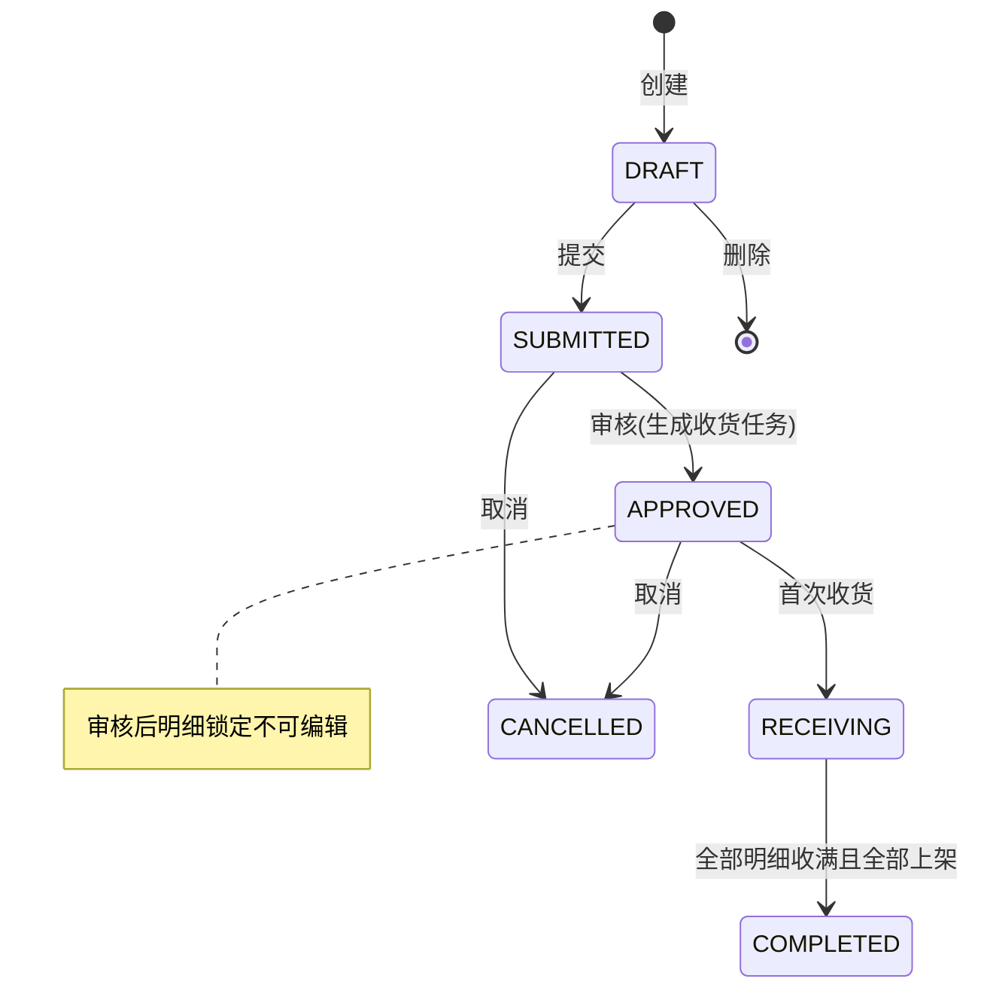
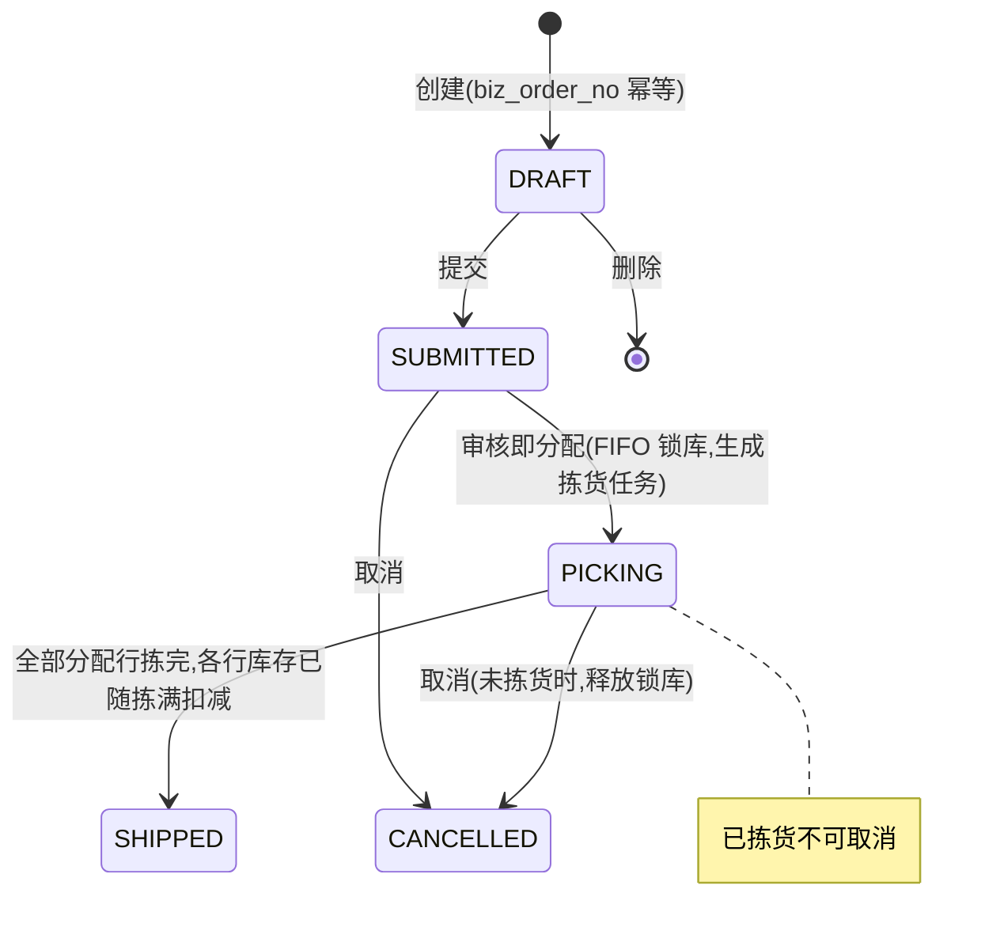
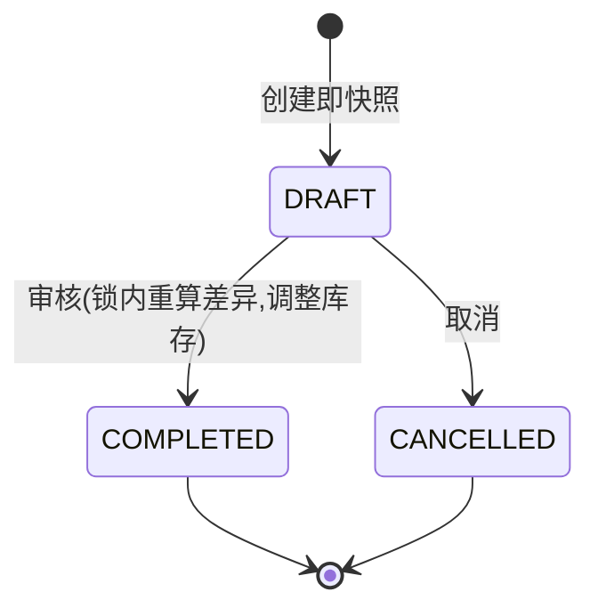
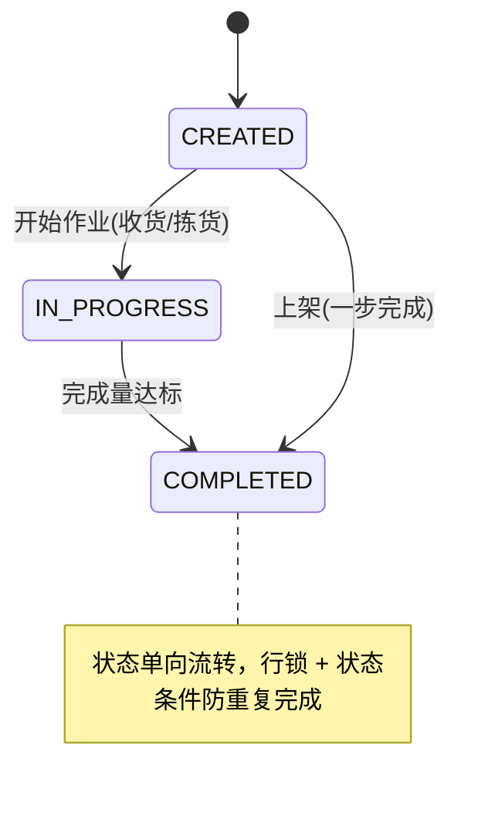

# WMS 需求规格说明书

> 版本：v1.1 ｜ 核心业务已实现，验收与边界按下文分别标注 ｜ 状态核对：2026-10-21（源码基线 `0e23f68`）。当前问题登记见 [问题总表](review-findings.md)，历史测试不是当前环境验收。

## 1. 项目概述

2026-10-22：基础功能进入收尾维护阶段，当前本地合集补齐仪表盘运营信息、表格调高、仓内移库和扫码辅助；具体操作见[仓储操作手册](warehouse-operations.md)，本轮验证和交付范围见[收尾验收](release-acceptance.md)。波次/播种现已按用户授权并入main合集，提供同仓选单、汇总拣货、软件槽位分货及逐单确认发货，详见[波次说明](wave-picking.md)。退货、质检冻结、效期、跨仓调拨等列为按真实需求启动的扩展，不是本次必须补齐的基础功能。

### 1.1 背景

中小仓储场景（电商自建仓、第三方小仓、门店后仓）普遍面临三个问题：

1. **库存账实不符**：缺少流水追溯，出了差异无从查起；
2. **超卖**：并发分配缺乏防护，库存被扣成负数；
3. **流程混乱**：单据状态随意跳转，操作无审计。

WMS 是一个**轻量级仓储管理系统**，以"功能简洁、工程亮点完整"为目标，覆盖 **入库 → 库存 → 出库 → 盘点** 的完整业务闭环，可作为中小仓库的生产起点，也可作为学习仓储领域与 Go 工程实践的可运行参考实现。

### 1.2 项目目标

| 目标 | 说明 |
| --- | --- |
| 业务闭环完整 | 入库单全流程、出库单全流程、盘点流程、统一任务中心均可跑通 |
| 库存强一致 | 任何并发操作下库存不超卖、不为负，全部变动有流水可追溯 |
| 流程严格可控 | 单据/任务状态机单向流转，非法跳转被拒绝 |
| 架构可演进 | 模块化单体，模块间仅通过接口通信，预留微服务拆分点 |
| 开箱即用 | 一条命令启动，自动建表 + 种子数据，前端开箱即连 |

### 1.3 术语表

| 术语 | 说明 |
| --- | --- |
| SKU | 最小存货单位（Stock Keeping Unit） |
| 库位（Location） | 仓库内最小存放空间，编码 `{库区}-{排}-{列}`，如 `A01-02-03` |
| 批次号（Batch No） | 同一 SKU 按入库批次的管理维度，FIFO 分配的依据 |
| 三数量 | `stock_quantity`（存量）= `available_quantity`（可用）+ `allocated_quantity`（出库已分配量，不是质量冻结） |
| 分配（Allocate） | 出库审核时按 FIFO 从可用量划拨到分配量的动作，即"锁库" |
| 收货 / 上架 | 入库的两个作业步骤：先按单收货确认数量，再把货放到具体库位 |
| 拣货 / 发货 | 出库的两个作业步骤：按分配行到库位拣货，全部拣完自动扣减库存 |
| 盘点（Stocktake） | 对指定范围的库存建立快照，录入实盘数并产生调整 |

## 2. 用户角色与权限

### 2.1 角色

| 角色 | 说明 |
| --- | --- |
| 超级管理员 | 内置角色 `admin`（权限串 `*`），拥有全部权限 |
| 业务角色 | 通过权限串组合授权，如 `wms:inbound:receive,wms:inbound:putaway` |

### 2.2 权限模型

- 权限串格式：`wms:{模块}:{动作}`，例如 `wms:outbound:approve`；
- 基础数据类写入统一为 `wms:basic`；
- 后端在路由级通过中间件校验（`middleware.Permission`），前端菜单、路由和操作按钮也按权限控制；前端可见性不能替代服务端授权。

### 2.3 权限清单

| 权限串 | 控制的操作 |
| --- | --- |
| `wms:system:user` | 用户增删改、启停、重置密码 |
| `wms:system:role` | 角色增删改 |
| `wms:basic` | 仓库/库位/货品的增删改、状态变更，以及基础资料标签预览 |
| `wms:inventory` | 库存及预警查看、库存流水追溯 |
| `wms:inventory:alert:manage` | 配置、暂停、删除库存阈值预警规则 |
| `wms:inbound:create` | 入库单创建/编辑/删除、Excel 导入 |
| `wms:inbound:submit` / `approve` / `cancel` | 入库单提交 / 审核 / 取消 |
| `wms:inbound:receive` / `putaway` | 收货 / 上架 |
| `wms:outbound:create` | 出库单创建/删除 |
| `wms:outbound:submit` / `approve` / `cancel` / `pick` | 出库单提交 / 审核(分配) / 取消 / 拣货 |
| `wms:stocktake:create` / `stocktake` / `approve` / `cancel` | 盘点创建 / 实盘 / 审核 / 取消 |

## 3. 功能需求

### 3.1 系统管理（system）

| 编号 | 需求 | 说明 |
| --- | --- | --- |
| FR-101 | 用户登录 | 用户名 + 密码（bcrypt 校验），签发 JWT；账号禁用后无法登录 |
| FR-102 | 用户管理 | 用户 CRUD、启用/停用、管理员重置密码；用户名唯一（软删除后可重建，唯一索引含 deleted_at 语义由代码保证） |
| FR-103 | 角色管理 | 角色 CRUD，权限串以逗号分隔存储 |
| FR-104 | 个人中心 | 查看个人信息、自助修改密码（需验原密码，改后强制重新登录） |
| FR-105 | 操作日志 | 所有写操作异步记录：用户、路径、方法、参数、IP、耗时、结果；支持按用户名/时间范围筛选 |

### 3.2 基础数据（basic）

| 编号 | 需求 | 说明 |
| --- | --- | --- |
| FR-201 | 仓库管理 | 仓库 CRUD、启停用；编码唯一 |
| FR-202 | 库位管理 | 按"库区前缀 × 排 × 列 × 层"**批量生成**库位（已存在的编码自动跳过，幂等）；支持禁用与删除 |
| FR-203 | 货品管理 | SKU CRUD，编码与条码唯一；条码支持按码即查（Redis 缓存条码→ID 映射，不可用时自动回源数据库） |
| FR-204 | 条码标签 | 货品/库位单行、所选或本页标签预览，A4 Code128固定规格；原值、尺寸及实机边界见[打印说明](document-printing.md) |

### 3.3 库存管理（inventory）

| 编号 | 需求 | 说明 |
| --- | --- | --- |
| FR-301 | 库存明细查询 | 按仓库/库位/SKU/批次查询 `wms_inventory`，展示三数量与入库时间 |
| FR-302 | SKU 汇总查询 | 按仓库聚合同 SKU 各批次的总存量/可用/分配 |
| FR-303 | 库存流水 | 每次变动记录 `RECEIVE/ALLOCATE/SHIP/RELEASE/ADJUST/MOVE_IN/MOVE_OUT` 流水：变更前后三数量、关联单号/任务号、操作人 |
| FR-304 | 库存增加（内部） | 上架时调用；同维库存行不存在则创建，存在则累加，同事务写流水 |
| FR-305 | 库存分配/释放/扣减/调整（内部） | 供出库/盘点模块通过接口调用，详见架构文档"核心设计" |
| FR-306 | 库存阈值预警 | 按仓库+SKU配置可用量下限，缺货/低库存查询、恢复与追溯；独立管理权限，无自动补货或推送，见[库存预警](inventory-alerts.md) |
| FR-307 | 库存Excel导出 | 明细与流水按筛选导出全部匹配记录，最多10000行，超限拒绝；字符串ID/编码及数值数量无损，见[导出说明](excel-export.md) |
| FR-308 | 仓内移库 | 同仓启用库位间移动可用量，批次与FIFO时间、成对流水、原请求恢复；见[仓内移库](stock-movement.md) |
| FR-309 | 扫码辅助作业 | 键盘型扫码枪/手动输入核对当前单据货品、同仓库位；收货定位明细，上架/拣货核对后显式确认，见[扫码说明](scan-assistance.md) |

### 3.4 入库管理（inbound）

| 编号 | 需求 | 说明 |
| --- | --- | --- |
| FR-401 | 入库单 CRUD | 草稿可编辑/删除；明细含 SKU、期望数量（批次号在收货时登记） |
| FR-402 | 单据流转 | 提交 → 审核（生成收货任务）→ 收货 → （全部上架后）自动完成；可取消 |
| FR-403 | 收货 | 按明细收货，可多次收、允许部分收；登记批次号（FIFO 依据）与良品/不良品数量 |
| FR-404 | 上架 | 为收货任务指定库位上架，库存 Increase + RECEIVE 流水，任务完成 |
| FR-405 | Excel 异步导入 | 上传入库单 Excel 后台解析创建；前端轮询进度（成功/失败行数）；服务重启后未完成任务 2 分钟内自动补偿执行 |
| FR-406 | 入库单打印 | 已保存明细的A4预览/浏览器打印，不修改收货上架状态，见[打印说明](document-printing.md) |

### 3.5 出库管理（outbound）

| 编号 | 需求 | 说明 |
| --- | --- | --- |
| FR-501 | 出库单创建 | 携带 `biz_order_no`（上游业务订单号），唯一索引幂等防重复建单 |
| FR-502 | **审核即分配** | 审核时按 FIFO（批次入库时间）从可用量分配到分配量（锁库），生成分配明细 `wms_allocation` 与拣货任务；库存不足则审核失败 |
| FR-503 | 拣货 | 按分配行到指定库位拣货，可分次拣；每条分配行拣满时在同事务内扣减该行 `stock` 与 `allocated`、写 SHIP 流水，`available` 不变（审核分配时已减少）；整单拣满后进入 SHIPPED |
| FR-504 | 取消释放 | 未发生拣货的订单可取消，释放全部锁库（allocated→available）+ RELEASE 流水；已拣货不可取消 |
| FR-505 | 出库/拣货单打印 | 原明细及分配库位、批次、已拣数量，无分配提示不可实际拣货，打印不扣减库存 |

### 3.6 盘点管理（stocktake）

| 编号 | 需求 | 说明 |
| --- | --- | --- |
| FR-601 | 创建即快照 | 按仓库（可限定库位）对现存库存行拍照 `book_qty`，不受后续变动影响 |
| FR-602 | 录入实盘 | 逐行录入实际数量，自动算差异 |
| FR-603 | 审核调整 | 审核时**在库存行锁内重算差异**（快照与当前账面可能已不同），按最终差异调整库存（stock/available 同步增减）+ ADJUST 流水；差异行标记已调整 |
| FR-604 | 取消 | 审核前可取消 |
| FR-605 | 盘点单打印 | 只含已保存实盘值，未录入留空、零值保留；打印不审核调账 |
| FR-606 | 盘点Excel导出 | 列表导出筛选范围的差异行，详情导出全部明细；未盘/零值、快照差异/审核调整量分开保存，见[导出说明](excel-export.md) |

### 3.7 任务中心（task）

| 编号 | 需求 | 说明 |
| --- | --- | --- |
| FR-701 | 统一任务 | 收货(RECEIVE)/上架(PUTAWAY)/拣货(PICK) 共用 `wms_task`，含目标量/完成量/操作人 |
| FR-702 | 任务查询 | 按类型/状态/关联单据分页查询，供作业人员领取工作 |

## 4. 业务流程需求（状态机）

### 4.1 入库单

### 4.2 出库单

### 4.3 盘点单

### 4.4 任务

**通用约束**：所有单据状态流转仅允许沿上述图转移（服务层显式校验）。状态推进由事务行锁加期望状态条件保护；收货量、拣货量、任务进度和分配进度使用 `version` 条件更新。

## 5. 非功能需求

| 编号 | 类别 | 需求 | 实现保障 |
| --- | --- | --- | --- |
| NFR-01 | 一致性 | 并发分配不超卖：库存不足的请求必须失败且不影响他人 | 事务 + `SELECT FOR UPDATE` 行锁 + `WHERE available >= N` 条件更新 + CHECK 约束三重防护（详见架构文档） |
| NFR-02 | 一致性 | 任何库存变动可追溯、可对账 | 全类型流水表，记录变更前后四元数量 |
| NFR-03 | 幂等 | 出库单重复创建、单据重复审核、任务重复完成不产生副作用 | 业务唯一键 + 状态机/行锁/CAS；五种作业已完成 Idempotency-Key + 同事务 wms_idempotency 去重与首次结果回放（2026-10-18 验收） |
| NFR-04 | 可用性 | Redis 故障时部分能力降级 | 单号生成降级 UUID、条码缓存回源数据库；演示会话仍依赖 Redis |
| NFR-05 | 可靠性 | 导入任务持久化并可恢复执行 | 状态机、CAS 执行权、逐行防重及悬挂扫描；D26 已验证进程中断恢复。源文件缺失明确失败，需核对已建单，不保证文件系统与数据库原子提交。 |
| NFR-06 | 安全 | 密码不明文、接口需登录、写操作有权限与审计 | bcrypt、JWT 中间件、权限中间件、异步操作日志 |
| NFR-07 | 性能目标（待规模验收） | 列表分页查询期望达到 100ms 量级，需注明负载与数据规模 | 已有索引不等于时延保证；D25 已完成有界本地服务/SQL规模与锁竞争实验，目标环境容量B16与D27持续查询计划审查仍保留，未承诺所有环境 ≤100ms。 |
| NFR-08 | 可维护性 | 模块可独立理解、可拆分 | 模块化单体与现有跨模块接口；demo 编排与部分业务联查有直接依赖，详见架构说明 |
| NFR-09 | 可验证 | 核心业务有针对性自动化回归 | 包含并发、防超卖、FIFO、取消/拣货/发货与幂等恢复等测试。完整验收及 CI 强制专用 MySQL/Redis，缺依赖或测试跳过不得算完整通过；仅显式可选的本地模式允许跳过。 |

## 6. 范围外与已知边界

### 6.1 当前范围外（保持轻量）

- 多货主（BO）体系；
- 库位混放策略、上架推荐算法（当前由人工指定库位）；
- 波次拣货、跨仓调拨、自动补货等进阶作业（当前可用库存阈值预警见[库存预警](inventory-alerts.md)，不自动生成补货任务）；
- 消息队列 / 分布式事务（当前单库事务已满足一致性目标）。

> 多租户在 v1.1 已扩展：共享库共享表，tenant_id 由 GORM 回调注入，平台旁路（tenant_id=0）与精确租户隔离并存。

### 6.2 简化实现（学习型项目取舍）

- 前端菜单、路由与操作按钮按权限控制；服务端仍独立校验权限；
- Excel 导入使用数据库任务队列；多实例需要共享导入文件，跨实例运行仍需验证；
- JWT 未做刷新令牌与黑名单（过期时间可配置）。

### 6.3 请求级幂等：基础验收与后续加固已完成

2026-10-18 幂等专项已完成实现与本地验收；2026-10-21 的 D11/D12/D13 分别补齐公共机制、分批清理与无歧义指纹。覆盖收货、上架、后台/PDA 拣货、PDA 领取和盘点审核，问题总表 F3/F6/F10 与相关 F8 已关闭。验收依据见 [开发与验证](development.md) 与 [迭代记录](iterations.md)。

- **业务键幂等已完成。** 出库单按租户内 `biz_order_no` 去重；外部下单核对同号请求的仓库、备注与规范 SKU/数量集合，同内容回放、异内容 409。Excel 导入按 `import_task_id + import_row` 防重；批量生成库位跳过已有编码；种子数据按租户及名称补齐。
- **服务端请求级幂等已完成。** 五种作业使用 `Idempotency-Key` 与 `wms_idempotency`，唯一键为 `(tenant_id, scope, idempotency_key)`；同 key 同内容回放首次成功结果，同 key 不同内容 409。幂等记录与业务写入同事务提交，失败整体回滚；同 key 并发通过唯一键、事务重试及回滚后新读核对，不重复累计数量、库存或流水。
- **前端操作生命周期已完成。** 每次真实操作生成独立 key，发送前持久化原参数；成功后结束本次操作，连续同参作业使用新 key；超时、断网、5xx 或结果未知保留原 key 原参数。刷新、关闭重开可恢复，账号/演示会话隔离待确认记录和内存状态，恢复提交同样防重复点击，发送中不能放弃记录，组件销毁注销存储监听。
- **异常恢复已完成。** 已完成单据仍显示待确认恢复入口，有 pending 的终态任务仍可选择；核对查询失败或请求取消返回 HTTP 503 / 50301，前端保留待确认记录，不降为确定未执行。真实后端成功后丢弃响应、刷新、原 key 原参数重试的 E2E 覆盖五种作业。

D13 的 v2 指纹、旧格式安全兼容、旧含分隔符记录 40901 需核对及混合部署限制，统一见 [Go 约定](go-style.md)。不能把“同 key 同内容可回放”扩展为接受所有历史含歧义编码的记录。

保留的能力边界：PDA 领取/拣货强制操作键，其余接口兼容无 key 调用，但无 key 不提供请求级去重。服务端记录保留 7 天，超过窗口先核对，不能自动重发；不同 key 可能是合法分次作业，不做通用 Redis 内容拦截。浏览器存储不提供跨标签页互斥，清缓存或换设备后不保证自动恢复。上述边界不属于本轮未完成项。

### 6.4 当前迭代顺序

已完成事项与后续需求分别列出；当前工程登记以 [问题总表](review-findings.md) 为准：

1. **已完成（2026-10-18）**：PDA 操作键生命周期、连续分次拣货、结果未知原参数重试与跨刷新恢复。
2. **已完成（2026-10-18）**：收货、上架、盘点审核请求级幂等及外部出库同业务单号内容核对。
3. **已实现并有本地验收记录（2026-10-20/21）**：业务页面/仪表盘、日夜主题、局部滚动、演示浮条拖拽与手机业务布局；记录见 [UI 记录](ui-review.md)。2026-10-22 在原仪表盘补充[当前库存预警、今日库存流水与历史异常导入](dashboard-operations.md)，保持四张主卡与局部滚动；主要业务列表可[自定义结果区高度](business-table-height.md)，默认一屏，主动拉高后允许页面滚动。不把历史浏览器夹具测试当作当前生产或实体手机验收。
4. **部分实现，部署验收仍开放**：D12/D26 业务指标、导入恢复与观测已完成本地验证；告警、生产监控栈、备份恢复和多实例按部署需求推进，见 [生产就绪评估](production-readiness.md)。
5. **可选增强，尚未实施**：单号生成替代降级、Redis AOF、降级打点告警与数据库号码段仅为候选方向，不是当前已承诺待修复的缺陷；前置条件和取舍见 6.5。

已完成的修复与待办清单见 [迭代记录与路线图](iterations.md)。最近验证结果及未覆盖范围见 [开发与验证指南](development.md)。

### 6.5 单号生成可采取的加固措施

实现见 `internal/pkg/orderno/orderno.go`，当前策略分三层：

1. **主方案**：Redis Lua 脚本原子执行 `INCR`，并在 key 首次创建时补设 48 小时 TTL。key 为 `gowms:orderno:{prefix}:{yyyyMMdd}`，日期已在 key 中，跨天自动换 key 从 1 重新开始，无需额外的跨日重置逻辑；
2. **降级方案**：Redis 报错或超时（500ms）时返回 `{prefix}{yyyyMMdd}F{UUID}`，`F` 用于标记该单号来自降级路径；
3. **最终兜底**：调用方依赖数据库唯一索引，插入冲突时重新生成（重试逻辑在各业务 Service）。

`Generator` 只依赖 `redis.UniversalClient` 接口，并允许 `rdb == nil`（完全降级模式）。

当前边界：

- **Redis 未显式开启 AOF**：`deploy/docker-compose.yaml` 的 redis 服务仅挂载 `redis_data:/data`，使用 `redis:7-alpine` 默认 RDB 快照，崩溃可能丢失最近若干秒的 `INCR`，重启后存在重号窗口，此时由数据库唯一索引拦截并重新生成；
- **降级单号可读性差**：包含 32 位去横线 UUID，长度大、不可排序、无业务含义，只能靠 `F` 标记降级来源；
- **无本地号段缓冲**：未使用进程内计数器，因此不存在“本地计数器重启归零”的问题，但也没有本地余量，Redis 不可用时会立即退化为 UUID。

可采取的措施（按投入产出排序，均为可选增强；当前三层策略已能保证单号唯一，下列措施不是正确性缺陷）：

| 序号 | 措施 | 收益 | 代价 |
| --- | --- | --- | --- |
| 1 | 降级单号改用项目已有的雪花生成器（`internal/pkg/snowflake`，已具备 `WMS_SERVER_NODE` 节点号与时钟回拨保护） | 单号有序、更短、有业务可读性；不引入新依赖 | 需保证多实例节点号唯一，仍由数据库唯一索引兜底 |
| 2 | 为 redis 服务显式开启 AOF（`appendonly yes`、`appendfsync everysec`） | 缩小 RDB 快照间隔内丢号导致的重号窗口 | 磁盘占用与写入开销上升 |
| 3 | 降级可观测性：Redis 报错触发降级时打点并告警 | 避免长期静默降级 | 需接入监控与告警规则 |
| 4 | Redis 单实例升级为主从/哨兵或 Cluster | 提升发号链路可用性 | 部署复杂度上升；因 `Generator` 只依赖 `redis.UniversalClient`，切换只需改客户端构造 |
| 5 | 引入数据库号码段模式（`wms_sequence` 表 + 双 buffer 预取） | 发号不依赖 Redis；重启后从数据库水位续发，多实例靠 `SELECT ... FOR UPDATE` 保证领到的区间不重叠 | 新增表与事务逻辑，号段会跳号；仅在发号量成为瓶颈或需要跨服务统一发号时评估 |

> 号码段模式的要点：数据库只存一行“已批发水位”（`current_value`），号段区间由客户端根据更新前后的水位自行推算；内存中同时持有当前号段与备用号段（双 buffer），当前号段用到约 10% 时异步预取下一段，从而避免“号段用尽瞬间才请求数据库”造成的卡顿；代价是进程重启会丢弃未用完的号码，即跳号。

---

> 架构与实现细节见 [architecture.md](./architecture.md)，表结构见 [database.md](./database.md)，接口清单见 [api.md](./api.md)。
